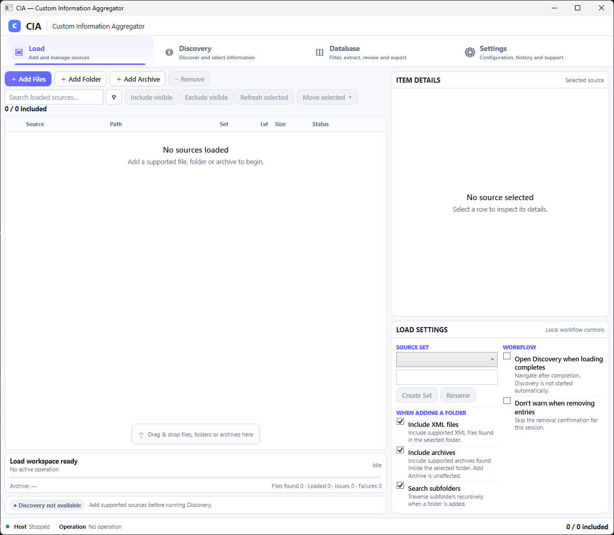

# Custom Information Aggregator

A Windows desktop application for turning large XML document sets into structured, reviewable and exportable information.

## What is this?

Custom Information Aggregator started as a practical response to a real Maintenance, Repair and Overhaul (MRO) problem: useful information can be buried inside thousands of structured technical documents, while extracting it manually is slow, repetitive and difficult to scale.

An earlier working prototype proved that a large part of that work could be automated. This repository is a ground-up rebuild of that idea as a configurable desktop application, with the emphasis shifted from a one-off automation script to a maintainable product with a clear workflow, formal requirements, architecture, automated verification and release planning.

The application is designed to let a user load large XML document sets, discover the information structures inside them, choose what matters, build a reviewable database and export the resulting information to Excel without manually searching through the source files.

## Basic workflow

1. **Load** files, folders or archives into the application.
2. **Discover** the XML information available across the loaded sources.
3. **Select** the information to keep, rename it where useful, and exclude unwanted data.
4. **Build the Database** from the selected information.
5. **Review** the resulting data and configure how it should be presented.
6. **Prepare and export** the required fields to Excel.

The major v1 workflow and UI structure are now frozen. Current work focuses on release readiness, compatibility validation, documentation and final verification.

## Installation

See the [CIA v1 Installation Guide](docs/installation/README.md) for supported Windows versions, installation, upgrades, uninstall behavior and release-installation troubleshooting.

## Development status

**Current stage: Release Candidate preparation**

- ✅ Core Load → Discovery → Database → Extraction / Review / Export workflow
- ✅ v1 UI/UX convergence and structure freeze
- ✅ Windows installer, shell integration, upgrade and uninstall lifecycle
- 🟡 Windows compatibility validation
- 🟡 Release documentation and final verification

### Release roadmap

| Milestone | Status |
|---|---|
| **Full Alpha** | Complete |
| **UI/UX convergence / Beta closure** | Complete |
| **Release Candidate** | In preparation |
| **v1.0.0** | After RC acceptance |

## Roadmap — after v1.0.0

The first planned follow-up is **bug fixing and cosmetic refinement**, followed by larger capabilities. This is a directional roadmap, not a promise of dates or finalized scope. Major features will require their own requirements, design, implementation and verification before release.

| Order | Planned milestone | What it would cover | Status |
|---|---|---|---|
| **1** | **v1.0.x — Bug fixes & cosmetic update** | Respond to early user feedback, fix confirmed defects, polish labels/layout/filter usability, and investigate sparse columns or blank source-aligned rows in the optional **One row per source file** mode (tracked as SPR-227). Preserve the accepted default output behavior. | Planned first post-release update; fixes depend on investigation |
| **2** | **Broader structured-file support** | Introduce **JSON and CSV** as input formats, including mapping their structures into CIA's discovery, selection, review and export workflow. | Future major feature — proposed |
| **3** | **HTML extraction** | Support selected HTML document structures such as tables or other discoverable elements, with the same review-before-export approach. | Future major feature — proposed |
| **4** | **Advanced extraction and output control** | Explore richer handling of repeated/nested structures, reusable extraction configurations and more flexible output layouts without losing source relationships. | Longer-term exploration |

The initial release remains focused on **XML**. JSON, CSV and HTML support are **not included in v1.0.0**. Image-based extraction is outside the committed roadmap.

For the initial release details, see [Release Notes / What's New](docs/release-notes/README.md). To report problems or suggest improvements after public support opens, see [Support](SUPPORT.md).

## For technical reviewers

The project is being developed as a full software-engineering lifecycle rather than only as a coding exercise. The current implementation uses **C# / .NET 10 / WPF**, with a separate desktop UI and processing host communicating through typed named-pipe IPC. Data-processing workflows use bounded/streaming approaches, SQLite-backed intermediate results and native `.xlsx` generation without requiring Microsoft Excel.

The repository also contains controlled requirements, architecture and delivery-planning baselines, with implementation work developed through short-lived branches and pull requests and supported by an automated test suite.

### Project baselines

- [STEP-001 — Project Initiation](docs/initiation/STEP-001-project-initiation-baseline.md)
- [STEP-002 — User Requirements](docs/requirements/STEP-002-requirements-baseline.md)
- [STEP-003 — System / Software Requirements Specification](docs/srs/STEP-003-srs-baseline.md)
- [STEP-004 — Architecture & Solution Design](docs/architecture/STEP-004-architecture-baseline.md)
- [STEP-005 — Delivery Planning / Backlog Decomposition](docs/delivery/STEP-005-delivery-plan-baseline.md)

Detailed controlled requirements, architecture decisions and traceability are maintained in Confluence; Jira is used to track SDLC execution and sprint work.
