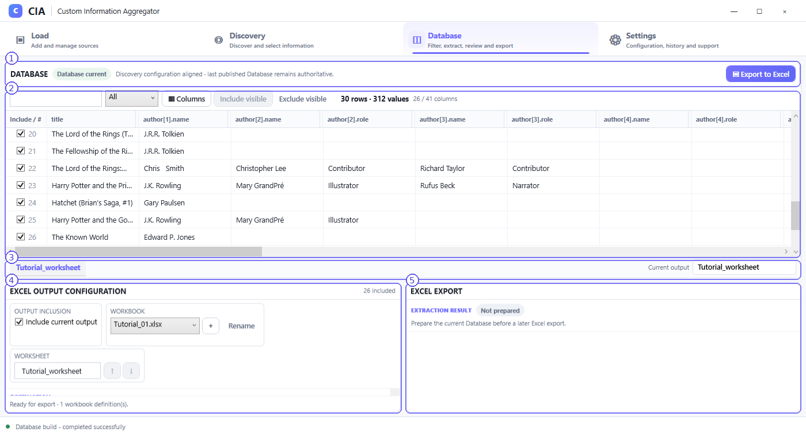
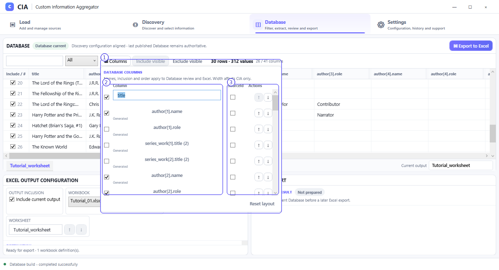

# Database — review and prepare results

The **Database** workspace displays the actual generated OutputSet records. It is the authoritative place to inspect included rows and set the visible/selected columns before export.

## Screenshot callouts

1. **Database status and export action.** The status label indicates whether the displayed Database is current for the Discovery configuration. **Export to Excel** begins the export workflow.
2. **Data grid and filtering.** Review field headers, values and included records. The search/filter area narrows the review; **Include visible** and **Exclude visible** apply to the visible rows where available. Horizontal scrolling provides access to additional columns.
3. **Output selector and name.** The lower strip identifies the currently displayed output. OutputSets remain separate; the selected output has its own configured worksheet name.
4. **Excel Output Configuration.** Decide whether the current output is included, choose or create its workbook assignment, and edit the worksheet name/order controls shown.
5. **Excel Export panel.** Shows preparation/export status, such as **Not prepared**, before an export is run. Follow the on-screen state rather than assuming previous extraction results still apply to an edited Database.

## Rows, values and columns are different quantities

The example screenshot shows **30 rows · 312 values · 26 / 41 columns**. These refer to different measurements:

- **Rows:** published result records in the current output (not Discovery occurrences).
- **Values:** stored nonempty/output value entries represented by the published output.
- **Included / total columns:** columns selected for presentation/export versus the full available set.

The exact numbers depend on the selected OutputSet, included rows and columns, interpretation mode and source files. Do not compare counters across different screenshot states as though they represent one unchanged configuration.

## Column management

1. **Columns panel.** Open **Columns** to manage how columns are presented and exported. **Reset layout** is available to restore the column layout settings shown.
2. **Include and rename.** Toggle included columns and change user-facing names where editable. Column names and order affect the current Database review and Excel value fields. A name override does not rewrite the original XML source.
3. **SourceId and ordering.** Where available, the **SourceId** checkbox includes a companion source-identity field; arrow controls change column order. Generated fields may display different editability from user-managed labels.

Database column widths primarily affect on-screen inspection. The included field list and presentation order are authoritative for the corresponding Excel value fields; workbook/worksheet routing is configured separately.

## Preparing for the next step

1. Select the intended OutputSet.
2. Review inclusion and values in the data grid.
3. Open **Columns**; adjust included fields, names and order as required.
4. Configure its workbook/worksheet in the lower panel.
5. Use **Export to Excel** when ready. CIA handles the corresponding extraction/preparation within its export workflow; a separate manual destination-preparation step is not required.

For workbook behavior, see [Excel Export](excel-export.md) and [Columns and Excel Configuration](columns-and-excel.md).
