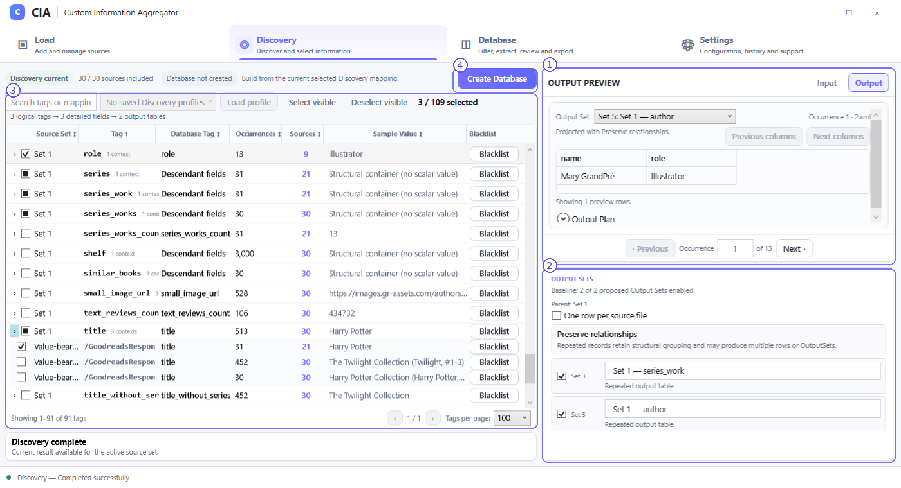

# Discovery — Output mode

**Output** is the pre-Database decision surface. It shows how CIA proposes to interpret the selected fields **before** the full Database is built.

## Screenshot callouts

1. **Output Preview.** Switch between **Input** and **Output** without losing the shared occurrence context. Choose a proposed OutputSet, inspect the projected columns/rows and open the **Output Plan** section. The preview is bounded: it helps you evaluate the projection without building the full Database.
2. **Output Sets.** Shows the parent set, enabled proposed derived OutputSets, editable names where supported and the interpretation mode. In the example, the normal mode **Preserve relationships** proposes multiple related output tables, and two are enabled.
3. **Selection table.** Input selections stay available on the left; changing the selection can change the proposed output plan. Review the effects before rebuilding.
4. **Create Database.** Builds the authoritative Database using the approved current selection and output mode.

## Default: Preserve relationships

With **One row per source file** unchecked, CIA preserves relevant structural grouping. If the selected XML contains independent repeated families, CIA can propose multiple derived OutputSets for the parent set. A book title, author name and role may appear in different relationship contexts and should not be merged just because a tag label happens to match.

This is the recommended first choice. You can enable or disable the proposed OutputSets before Database creation. **One enabled OutputSet becomes one Excel worksheet.** Several worksheets may belong to the same managed workbook.

## Optional: One row per source file

The checkbox **One row per source file** changes the output model for the current parent Source Set:

- **Unchecked (default):** Relationship-preserving OutputSets, potentially multiple tables for distinct record families.
- **Checked:** One combined OutputSet for that parent, with one output row per included, successfully interpreted source file. Repeated structural values may expand into numbered columns, with blank cells where a file lacks a field.

This option preserves source identity and structural association rather than forcing every file into compact columns. A source with no selected value can therefore still have an identifiable blank data row. In wide cases, the program warns when the planned width exceeds **500 output columns**; the warning is not automatically a refusal to continue. Excel's actual column limit remains a separate hard boundary.

The source-file mode preview can show **10 columns per page**. The source-local preview may be narrower than the eventual dataset-wide schema until the current full schema is known. A preview never removes legitimate values from the final output.

**Known limitation:** Source-file mode can produce many sparsely populated repeated columns and blank source rows. If you need a more compact, family-oriented output, prefer **Preserve relationships**. See [Known Limitations](known-limitations.md).

## Before creating the Database

1. Confirm the intended detailed-field selection in Input mode.
2. In Output, review the proposed groups and representative rows.
3. Select the interpretation mode for the parent set.
4. Confirm the required OutputSets are enabled and their names make sense.
5. Choose **Create Database**.

**Important:** Changing preview settings does not itself create a new published Database. The Database remains the authoritative materialized result; rebuild when you want changes to take effect downstream.
