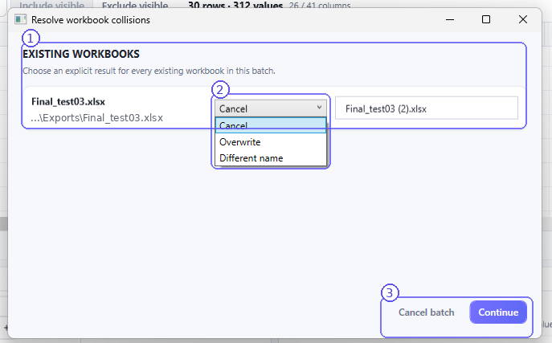

# Excel Export — worksheets, workbooks and save results

CIA writes selected structured data into `.xlsx` files. Export is initiated from the **Database** workspace. You do not need to open Excel to complete CIA's save workflow.

## Export configuration

1. **Include current output** only for those OutputSets you intend to export.
2. Under **Workbook**, select an existing CIA-managed workbook definition or create another using the visible controls.
3. Under **Worksheet**, set the visible worksheet name and order where supported.
4. Review the included Database columns through **Columns**. Their inclusion and order carry through to Excel value fields.
5. Select **Export to Excel**. Follow CIA's destination selection and save flow.

**Routing rule:** **One derived OutputSet = one worksheet.** Multiple OutputSet worksheets can share a workbook. CIA applies Excel-compatible naming and uniqueness rules; the initial name commonly combines its parent and derived set names, while the current UI lets you manage routing and names.

## Saving a workbook

CIA supports the configured **Save to / Browse / Ask** destination behavior. Depending on the current setting, an export may proceed toward a configured folder or present the normal destination prompt. A direct **Export to Excel → Save** flow is valid; this manual does not require a prior separate preparation command.

If CIA is configured to open the exported file after successful export, it will attempt the post-export action as configured in Settings. This action is distinct from whether the workbook was successfully written.

## Existing-file collision

1. **Existing Workbooks** lists destination workbooks already present, with an explicit action required for the affected output.
2. **Collision action** offers **Cancel**, **Overwrite** or **Different name** in the shown dialog. The selected action controls what happens to the existing workbook.
3. **Continue** confirms the chosen resolution for the batch. **Cancel batch** returns without proceeding with those workbook changes.

For a first tutorial export, choose a new workbook filename to avoid overwriting previous results. Never select **Overwrite** unless you intend to replace the named file.

## Batch export

When multiple OutputSets are enabled, CIA can route worksheets to one or more workbooks. Check each workbook definition and per-output inclusion before starting. A collision affecting one or more destinations may require a deliberate resolution; do not assume the entire batch silently overwrites files.

## What CIA confirms

The application reports completion or failure through the visible operation status and **Settings → Log & Diagnostics**. A successful export means CIA completed the workbook-save workflow; the user's downstream Excel analysis is outside the scope of this interface manual.

If your selection or Database mapping changes later, update/rebuild the relevant result and then export again so the workbook reflects the intended current state.
