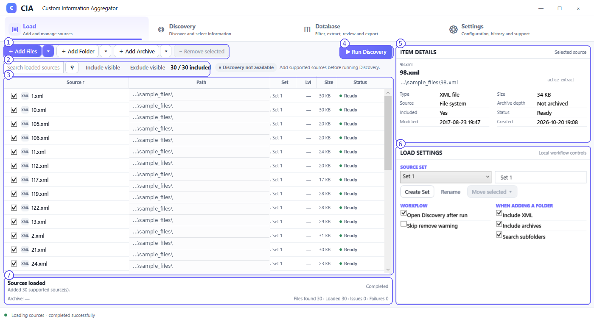
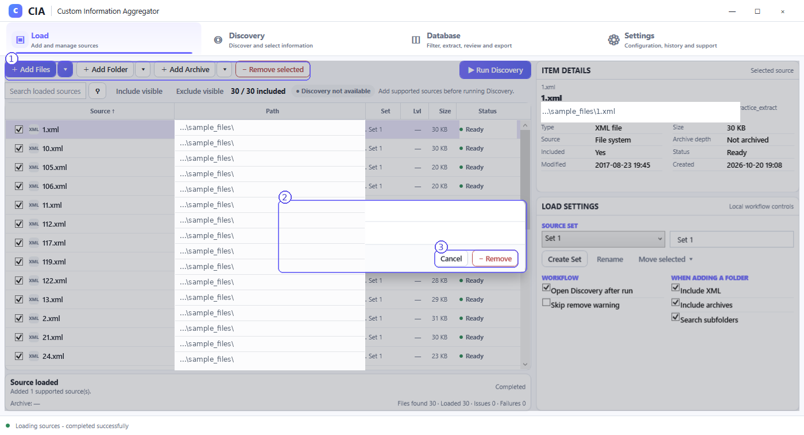

# Load — add and manage sources

The **Load** workspace controls which input files CIA knows about, whether each file is included, and which parent **Source Set** owns it. Adding a file does not itself generate the Discovery results or Database.

## Screenshot callouts

1. **Add controls.** **Add Files**, **Add Folder** and **Add Archive** are the primary ways to supply sources. The adjacent dropdown arrows offer the control's available choices where applicable. Use the method matching your material; no manual archive extraction is required for supported archives.
2. **Search and inclusion.** **Search loaded sources** narrows the displayed list. **Include visible** and **Exclude visible** act on the visible subset. The inclusion counter in the example reads **30 / 30 included**.
3. **Source table.** Each row shows a source filename, path, set, archive level, size, inclusion checkbox and status. Click a row to inspect it. The inclusion checkbox controls whether that source participates; it is distinct from choosing rows for actions such as removal.
4. **Run Discovery.** Starts the Discovery pass for the current included sources. The screenshot shows the button available while Discovery results have not yet been created.
5. **Item Details.** Shows information about the selected source, including type, size, archive depth, whether it is included, and status. File paths shown in this manual are anonymized.
6. **Load Settings.** Select the active **Source Set**, create or rename sets, and move selected sources where enabled. The **Workflow** options include **Open Discovery after run** and **Skip remove warning**. Folder options cover **Include XML**, **Include archives** and **Search subfolders**.
7. **Operation summary.** Shows the latest load outcome, such as the number of sources found, loaded and failed. The bottom status strip also reports operations.

## Adding material

1. Choose **Add Files**, **Add Folder** or **Add Archive**.
2. Select the source(s) in the Windows dialog.
3. Verify the loaded rows and the operation summary. In the screenshot, CIA shows **30 files found, 30 loaded, 0 issues, 0 failures**.
4. Check the inclusion column and use the visible-list controls if needed.
5. Run Discovery when the source list is ready.

**About sets:** CIA creates **Set 1** for the initial workflow. You can create additional parent sets when separate source groups require independent ownership. See [Sets and OutputSets](sets-and-outputsets.md).

## Removing a loaded entry

1. Select the row or rows to remove. A selected action row is not the same thing as an included source checkbox.
2. Click **Remove selected**. CIA displays a confirmation showing the number of selected entries.
3. Choose **Remove** to confirm or **Cancel** to keep the entries. The **Skip remove warning** setting changes whether the confirmation is shown.

The screenshot documents removal **from the loaded source list**. It does not establish deletion of the XML file from your computer; do not interpret it as a file-system delete instruction.

## Source status and readiness

- **Ready** indicates that a displayed source is ready for the supported workflow.
- The separate **Discovery not available** message means you have not yet established usable current Discovery results for that configuration.
- An operation may have its own success, warning or error message. Inspect the operation summary and **Settings → Log & Diagnostics** for details.
- If the source selection changes after processing, rebuild the affected downstream result before trusting the next export.
