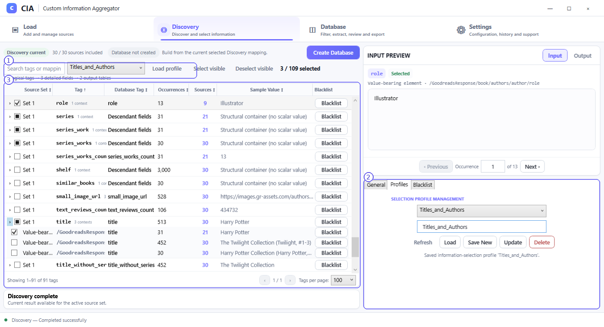
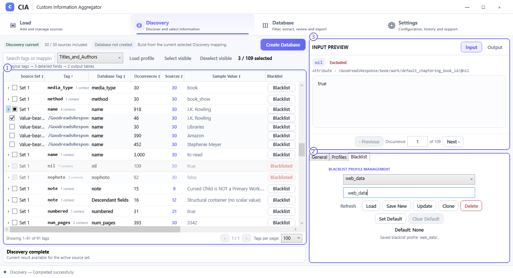

# Selection Profiles and Blacklists

Two reusable mechanisms appear in the Discovery sidebar. They serve different purposes:

- **Selection profile:** Saves a set of Discovery information selections for reuse.
- **Blacklist profile:** Records fields/tags you want excluded from the Discovery selection experience.

## Selection profiles

1. **Discovery toolbar profile selector:** Choose a saved Discovery profile and use **Load profile** to apply it when available.
2. **Profiles panel:** Name, save, load, update or delete saved information-selection profiles through the displayed controls. The screenshot illustrates a profile named `Titles_and_Authors`.
3. **Selected detailed fields:** Inspect the tag list and checkmarks to understand what the currently applied selection contains; do not infer selections exclusively from the profile name.

A saved profile is a convenience for repeated configuration. Review its actual selections against your current sources and contexts before building the Database.

## Blacklist profiles

1. **Blacklist entries:** Blacklisted rows are visually distinguished; use the row's blacklist action to control whether it is blocked. An entry can be restored to neutral selection state through the supported UI.
2. **Blacklist panel:** Use the displayed **Load**, **Save New**, **Update**, **Clone**, **Delete**, **Set Default**, and **Clear Default** controls as applicable. The screenshot shows a saved profile called `web_data` and displays its default-state text.
3. **Input Preview:** Inspect a selected row's occurrence and its blacklist state when you need to understand what that entry represents.

## Visibility is not selection

The Input **General** tab includes switches such as **Show blacklisted tags**, **Show only selected**, and **Show only direct selections**. These are list-view controls. Hiding a row from the list does not by itself mean that row has been deleted from the source file.

## Good practice

After loading a selection or blacklist profile, inspect the current tag tree and [Discovery Output](discovery-output.md) plan. Profiles can simplify repetitive work, but the current sources and structural contexts remain the authoritative basis for the proposed output.
