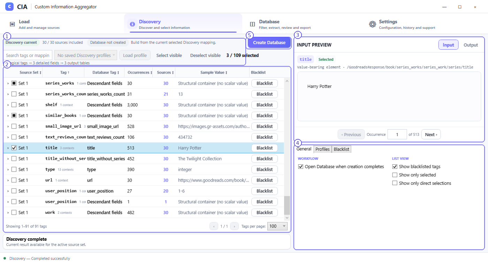

# Quick Start — first workbook

The screenshots use a selection of **30 Goodbooks XML files**. Sample files are not bundled with CIA; you can follow the same steps using your own supported XML files.

## 1 — Load the files

1. Open **Load** and select **Add Files** to choose XML files, or **Add Folder** to choose a folder containing them.
2. Confirm the list contains your intended sources and that each relevant source is **included** and **Ready**.
3. Leave the files in **Set 1** unless you need to organize separate inputs into additional sets.
4. Click **Run Discovery**. If **Open Discovery after run** is checked, CIA opens Discovery after a successful run.

## 2 — Select information

1. In **Discovery**, work initially in **Input** mode.
2. Search or browse the tags; expand a tag that has multiple structural contexts.
3. Use the checkboxes to select the specific values or contexts you want. In this example, the author worked with titles, authors and related information.
4. Check **Input Preview** to confirm that the selected occurrence is the value or field you intended.

## 3 — Inspect the proposed output

1. Switch from **Input** to **Output**.
2. Inspect **Output Preview** and the enabled **Output Sets**.
3. For a typical first run, leave **One row per source file** unchecked: **Preserve relationships** keeps structurally related records together.
4. Keep the desired proposed OutputSets enabled; disable any you do not need.
5. Click **Create Database**. The Database is generated from the current approved selection and output settings.

## 4 — Review and export

1. Open **Database** if CIA has not opened it automatically.
2. Review the rows and selected fields. Use **Columns** if you need to hide, rename or reorder fields.
3. Confirm that the required output is checked under **Excel Output Configuration**, with the intended workbook and worksheet names.
4. Select **Export to Excel** and complete the save flow. CIA may ask you to resolve a destination conflict if a workbook already exists.
5. Confirm the success result inside CIA. This manual does not require opening Excel to understand the application workflow.

**Expected result:** An Excel workbook containing the included CIA OutputSet worksheet(s), according to your selections and naming. The precise number of rows, values and columns depends on the 30 XML files and the fields selected.

> **Where next?** Read [Load](load.md) and [Discovery Input](discovery-input.md) for the complete control-by-control explanation.
