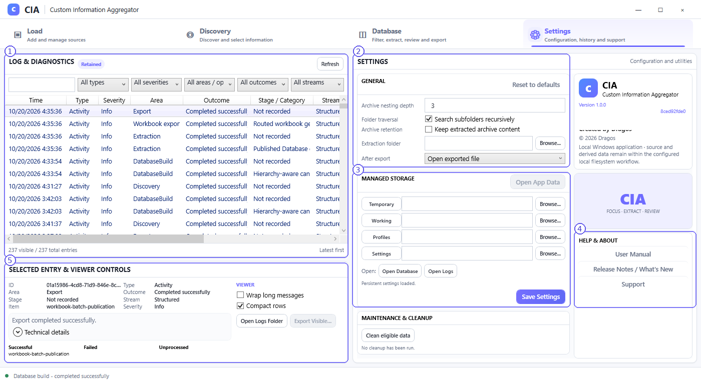

# Settings and Log & Diagnostics

**Settings** contains general application configuration, managed storage controls, operation logs and help links.

## Screenshot callouts

1. **Log & Diagnostics.** Review the chronological activity list. Filter by type, severity, area/operation, outcome and stream. Select an entry for more detail; the screenshot shows completed Database and export activities.
2. **General settings.** Set the supported archive nesting depth, folder traversal behavior, whether extracted archive contents are retained, and the extraction folder. **After export** controls behavior such as opening the exported file. Click **Save Settings** to persist changes.
3. **Managed Storage.** Shows paths/actions for temporary, working, profile and settings areas. The visible controls also include **Open Database** and **Open Logs** where available. Storage settings should be changed deliberately.
4. **Help & About.** **User Manual**, **Release Notes / What's New** and **Support** open their configured documentation destinations in a browser. The top area displays the application version/build information.
5. **Selected Entry & Viewer Controls.** Inspect an activity's detail and technical information; use **Wrap long messages**, **Compact rows** or the available log-folder actions to read diagnostics more comfortably. The lower-left panel is an inspection surface, not an Excel data grid.

## General settings

| Setting | Purpose |
|---|---|
| **Archive nesting depth** | Sets the configured limit for traversing supported nested archives. |
| **Search subfolders recursively** | Controls folder traversal under selected folders. |
| **Keep extracted archive content** | Controls retention of eligible extracted archive material. |
| **Extraction folder** | Chooses where extraction-related output is stored. |
| **After export** | Configures supported behavior after a successful export, such as opening the exported file. |
| **Reset to defaults** | Restores supported setting defaults; review the effect before applying it. |

## Log workflow

1. Use **Refresh** if you need the latest activity list.
2. Narrow the list with filters or the search box.
3. Click a record and read its details below, including operation and outcome.
4. For additional information, expand **Technical details** or use **Open Logs Folder** where available.

Logs help distinguish an unexpected result from an incomplete operation. The log's **Area**, **Outcome** and **Stage/Category** labels should be read together.

## Maintenance and unavailable capabilities

**Clean eligible data** is a maintenance action for supported temporary/session data; inspect its prompts before proceeding. **Working State / Recovery** and **Decomposer** are **not available as active v1 user workflows**. Their historical design references do not mean these tools can be used in this release.
